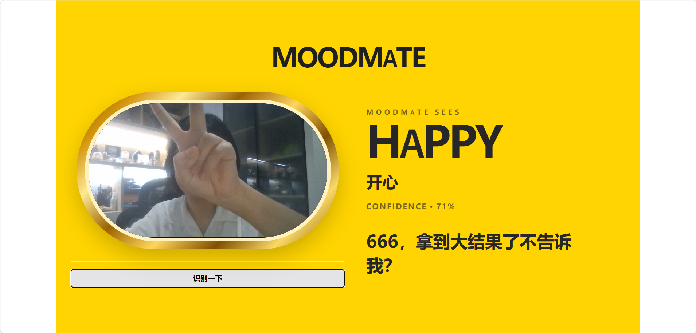

# MoodMate

A lightweight facial-expression-aware interactive mirror built with ResNet18, YuNet and Gradio.

## Demo

## Overview

MoodMate is an AI interaction demo designed around a smart-mirror concept.

The browser camera stays active as a live mirror. When the user clicks the recognition button, MoodMate captures the current frame, detects the face, classifies the visible facial expression, and returns one playful response together with an emotion-themed interface.

MoodMate recognizes visible facial-expression patterns. It does not determine a person's true emotional or psychological state.

## Features

- Browser-based live camera
- One-click snapshot recognition
- YuNet face detection
- Fine-tuned ResNet18 facial-expression classifier
- Seven expression categories:
  - Angry
  - Disgust
  - Fear
  - Happy
  - Sad
  - Surprise
  - Neutral
- Random local response strategy
- Emotion-adaptive page colors
- No LLM API required

## Pipeline

Browser Camera
→ Snapshot Capture
→ YuNet Face Detection
→ Face Crop
→ Fine-tuned ResNet18
→ Expression Classification
→ Local Response Strategy
→ Dynamic MoodMate UI

## Project Structure

MoodMate/
- app.py
- requirements.txt
- README.md
- .gitignore
- models/
  - moodmate_finetuned.pth
  - face_detection_yunet_2023mar.onnx
- notebooks/
  - MoodMate_FineTuning.ipynb
- assets/
- src/

## Model

The facial-expression classifier uses an ImageNet-pretrained ResNet18 fine-tuned on FER2013.

YuNet is used as a lightweight face detector before expression classification.

## Run Locally

Install dependencies:

pip install -r requirements.txt

Start MoodMate:

python app.py

Then open the Gradio URL in your browser and allow camera access.

## Tech Stack

Python, PyTorch, torchvision, OpenCV, YuNet, ResNet18, Gradio, JavaScript, HTML and CSS.

## Limitations

Recognition performance may vary with lighting, pose, glasses, camera quality and differences between FER2013 and real-world webcam images.

MoodMate is intended as an interactive AI demo rather than a system for assessing a person's actual emotional or psychological state.